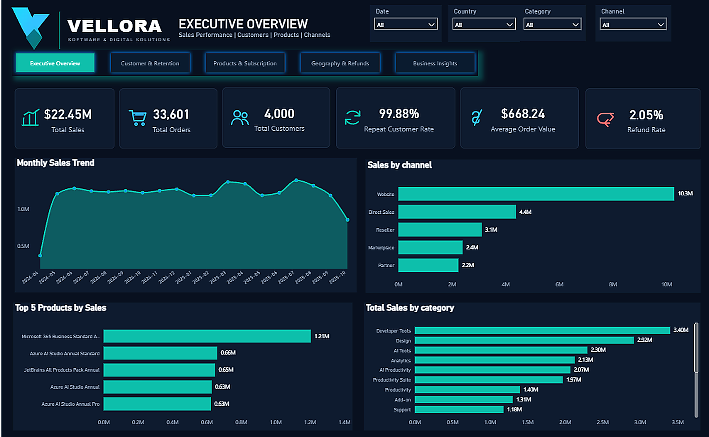
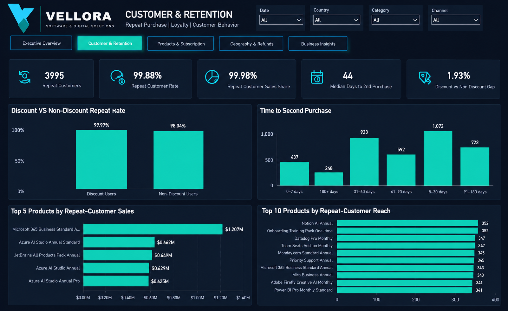
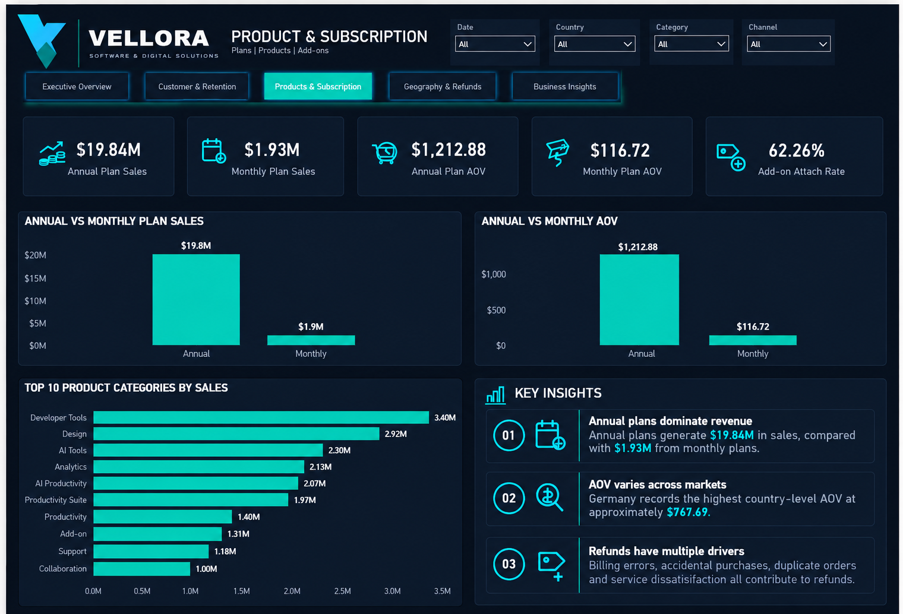
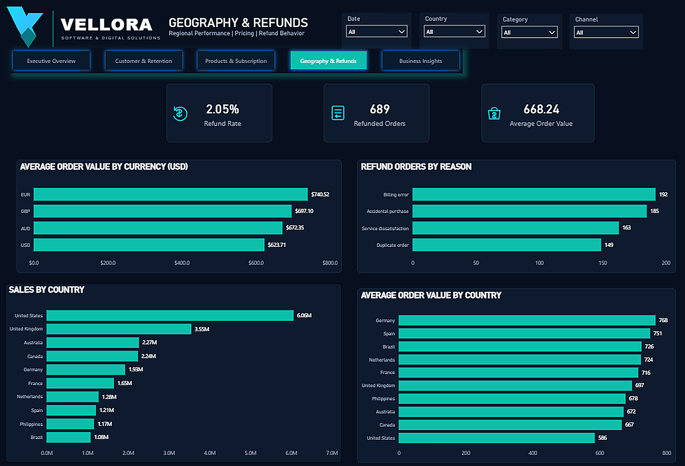
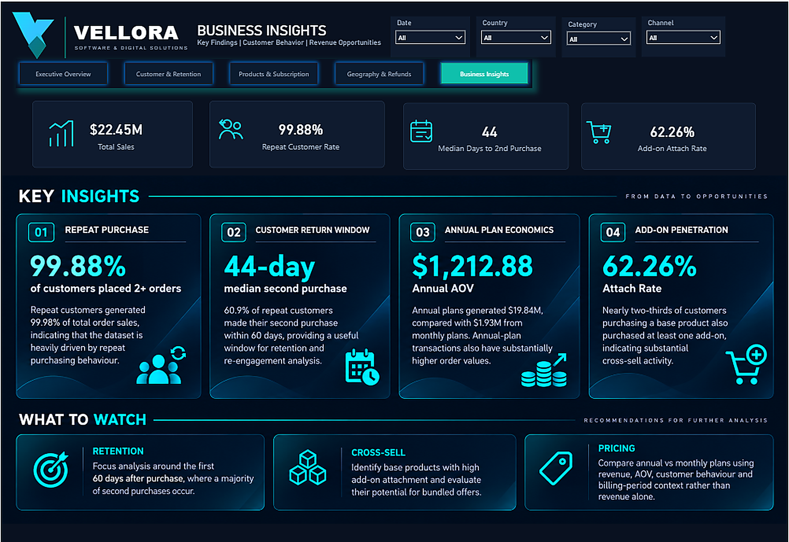

# DataDNA E-commerce Analytics Dashboard

**November 2025 E-commerce Analytics Challenge**  
**Tools:** MySQL | SQL | Power BI | DAX

A five-page Power BI analytics project analyzing sales performance, customer retention, repeat purchasing, product/subscription economics, geography, refunds, and cross-sell behaviour for a global software retailer.

## Dashboard

| Page | Focus |
|---|---|
| 01 | Executive Overview — sales, orders, customers, channels and products |
| 02 | Customer & Retention — repeat purchase behaviour, second-purchase timing and discount association |
| 03 | Product & Subscription — annual vs monthly plans, category sales and add-on penetration |
| 04 | Geography & Refunds — country/currency AOV, sales geography and refund reasons |
| 05 | Business Insights — key findings and areas for further analysis |

### Preview

#### Executive Overview


#### Customer & Retention


#### Product & Subscription


#### Geography & Refunds


#### Business Insights


## Key Metrics

- **Total order sales:** $22.45M
- **Total orders:** 33,601
- **Customers:** 4,000
- **Repeat customers:** 3,995
- **Repeat customer rate:** 99.88%
- **Repeat customer sales share:** 99.98%
- **Median time to second purchase:** 44 days
- **Refunded orders:** 689
- **Refund rate:** 2.05%
- **Annual-plan sales:** $19.84M
- **Monthly-plan sales:** $1.93M
- **Annual-plan AOV:** $1,212.88
- **Monthly-plan AOV:** $116.72
- **Add-on attach rate:** 62.26%

## Analytical Approach

### Purchase definition
Only `event_type = 'order'` is treated as a new purchase. `invoice` events represent billing/renewal activity and are excluded from new-purchase metrics.

### Repeat customer
A repeat customer is a customer with **2 or more order events**.

### Second-purchase timing
First and second qualifying orders are ranked chronologically per customer using `ROW_NUMBER()`. The median time to second purchase is then calculated from the resulting customer-level intervals.

### Discount analysis
Customers are classified according to whether they used a positive discount on at least one order. The difference in repeat rates is treated as an **observed association, not causal evidence**.

### Add-on attach rate
Customer-level intersection of customers purchasing at least one non-add-on/base product and customers purchasing at least one add-on.

## Data Quality Notes

- 48,000 event records were audited.
- No duplicate `event_id` values were found.
- No missing product/customer IDs were found in the event table.
- Event dates require parsing from `DD-MM-YYYY HH:MM` text format.
- A substantial number of events occur before the customer-table `signup_date`; therefore signup date is not used as a proxy for first purchase or customer tenure.
- Revenue is normalized to USD using the dataset's FX field.

## Repository Structure

```text
DataDNA-Ecommerce-Analytics/
├── README.md
├── sql/
│   └── ecommerce_analysis.sql
├── powerbi/
│   └── README.md
├── screenshots/
│   ├── 01_executive_overview.png
│   ├── 02_customer_retention.png
│   ├── 03_product_subscription.png
│   ├── 04_geography_refunds.png
│   └── 05_business_insights.png
└── documentation/
    ├── DAX_Measures.md
    └── Vellora_Logo.svg
```

## Notes

The raw challenge dataset is intentionally not included in this public repository. Add the final `.pbix` file under `powerbi/` after checking the challenge/data redistribution terms.
